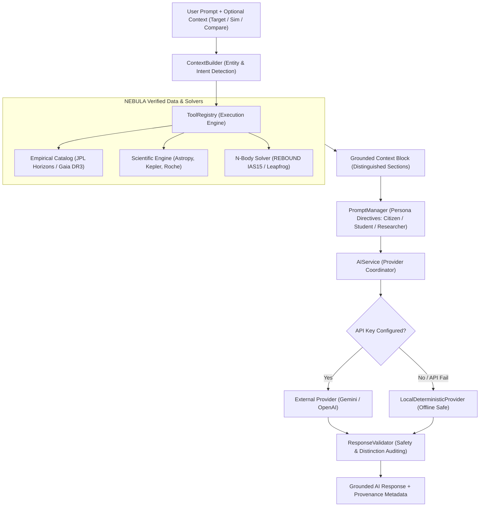

# NEBULA Grounded AI Astronomy Assistant: Architecture & Grounding Strategy

## 1. Overview & Architectural Philosophy

The **NEBULA Grounded AI Astronomy Assistant** is not a generic, unconstrained conversational chatbot. It is a domain-specific, scientifically grounded intelligence engine designed for observational and theoretical astronomy.

### Core Principles:
1. **Factual Grounding**: When answering numerical or physical questions, the assistant retrieves exact measurements from NEBULA's catalog and calculations from the scientific engine rather than fabricating values.
2. **Provider-Agnostic Abstraction**: LLM backends are decoupled from application logic. The platform supports Google Gemini, OpenAI, and a fully deterministic local fallback engine.
3. **Scientific Safety**: If a requested parameter is unmeasured or unavailable, the system explicitly states that the data is unavailable rather than generating a synthetic approximation.
4. **Tri-Mode Adaptive Persona**: Answers are dynamically calibrated to the cognitive level, vocabulary, and mathematical depth of three personas: **Citizen**, **Student**, and **Researcher**.
5. **Contextual Navigation**: Relevant context (target body, N-body simulation run, or comparison set) is automatically passed when opening the assistant from any platform view.

---

## 2. System Architecture

The AI subsystem is located in `backend/app/ai/` and organized into six modular abstractions:

```
backend/app/ai/
├── __init__.py               # Package export interface
├── base.py / providers.py    # AIProvider ABC, Gemini, OpenAI, LocalDeterministicProvider
├── tools.py                  # ToolRegistry and executable tool functions
├── context_builder.py        # ContextBuilder: entity detection & grounded telemetry extraction
├── prompt_manager.py         # PromptManager: persona directives & grounding mandates
├── response_validator.py     # ResponseValidator: scientific safety & consistency auditing
└── service.py                # AIService: high-level coordinator & automatic failover
```



---

## 3. AI Tools & Tool Registry (`backend/app/ai/tools.py`)

Tools provide direct, read-only interfaces to NEBULA's databases, analytical equations, and numerical integrators. Each tool defines a JSON schema, parameter constraints, and an executable function.

| Tool Name | Parameters | Description |
| :--- | :--- | :--- |
| `get_object` | `object_id: str` | Retrieves verified empirical records for a celestial body by slug or name. |
| `search_objects` | `query: str, limit: int` | Searches catalog by keyword, name, category, or physical feature. |
| `compare_objects` | `object_ids: List[str]` | Generates parametric comparison matrix, physical ratios, and percentage differences between 2–6 bodies. |
| `get_object_properties` | `object_id: str, properties: List[str]` | Extracts specific properties; explicitly flags unavailable fields. |
| `calculate_orbital_property` | `property_name: str, params: dict` | Computes gravitational force, orbital velocity, orbital period, escape velocity, Hohmann transfer, Hill sphere, or Roche limit. |
| `get_simulation` | `simulation_id: str` | Retrieves metadata, status, parameters, and scenario definition for an N-body run. |
| `get_simulation_results` | `simulation_id: str` | Retrieves trajectory snapshots, relative energy error ($\Delta E/E_0$), and conservation metrics. |
| `explain_simulation_result` | `simulation_id: str` | Analyzes numerical stability, symplectic energy drift, and orbital lifetime. |
| `query_strongest_gravity` | `category: Optional[str]` | Queries catalog to rank and identify bodies with the highest surface gravity. |

### REST Tool Discovery & Execution:
- `GET /api/v1/ai/tools`: Returns the complete registry schema.
- `POST /api/v1/ai/tools/{tool_name}/execute`: Executes a tool directly with arbitrary arguments.

---

## 4. Grounding Strategy & Explicit Distinctions

To ensure complete clarity and academic transparency, every grounded response clearly distinguishes four information tiers:

1. **`[NEBULA Data]`**:
   Direct empirical measurements extracted from catalog databases (mass in kg, radius in km, semi-major axis in AU, orbital period in days). Always accompanied by source provenance (NASA JPL Horizons, Gaia DR3, SIMBAD).
2. **`[Computed Result]`**:
   Values calculated via deterministic physical equations or numerical solvers (e.g. Vis-Viva orbital velocity, fluid Roche tidal limit, Hohmann $\Delta v$, REBOUND relative energy drift).
3. **`[External Scientific Context]`**:
   Observational history, space mission findings (Cassini, Juno, Voyager), or peer-reviewed literature explaining the broader context.
4. **`[General Explanation]`**:
   Intuitive physical explanations and analogies tailored to the active user persona.

---

## 5. Mode Adaptation

The assistant adapts its vocabulary, mathematical rigor, and pedagogical scaffolding according to the active mode:

### 1. Citizen Mode
- **Language**: Accessible, inspiring plain English.
- **Cognitive Level**: General public, all ages.
- **Techniques**: Relatable everyday analogies (comparing planetary masses to Earth counts, gravity to human body weight, sizes to everyday objects).
- **Restrictions**: Zero impenetrable mathematical jargon; short and engaging answers.

### 2. Student Mode
- **Language**: Encouraging, structured university physics tutor.
- **Cognitive Level**: High school / undergraduate physics.
- **Techniques**: Step-by-step physical principles, intuitive formulas ($T^2 \propto a^3$, $F = G\frac{m_1 m_2}{r^2}$, $g = \frac{GM}{R^2}$), and connections between observation and physical law.
- **Engagement**: Every response concludes with an interactive **"Comprehension Check"** question or thought experiment.

### 3. Researcher Mode
- **Language**: Formal academic prose and peer-reviewed terminology.
- **Cognitive Level**: Postgraduate and professional astrophysics.
- **Techniques**: Exact SI and astronomical units ($M_\odot, M_\oplus, \text{AU}, \text{km/s}$), LaTeX mathematical formulas ($...$, $$...$$), state vectors, secular resonances, hydrostatic equilibrium, and explicit boundary assumptions.

---

## 6. Deterministic Local Fallback Engine

NEBULA is **100% functional locally without requiring an API key or internet access**.

When no `GEMINI_API_KEY` or `OPENAI_API_KEY` is set in the environment—or if a network request to an external provider fails—the system automatically routes requests through `LocalDeterministicProvider`:

- **Deterministic Query Resolvers**:
  - *"What is the mass of Jupiter?"* $\rightarrow$ Retrieves Jupiter's exact catalog mass ($1.8982 \times 10^{27}\text{ kg} = 317.83\,M_\oplus$) and formats across Citizen, Student, and Researcher personas.
  - *"Compare Earth and Mars"* $\rightarrow$ Invokes `tool_compare_objects`, computes precise ratios (mass 0.107x, gravity 0.38x, distance 1.52x), and synthesizes comparative differences.
  - *"Explain Earth's orbital period"* $\rightarrow$ Derives the sidereal period ($365.256\text{ days}$) using Kepler's Third Law ($T = 2\pi\sqrt{a^3/GM_\odot}$) and explains the origin of leap years.
  - *"Why does Saturn have rings?"* $\rightarrow$ Evaluates the fluid Roche limit ($d \approx 125,300\text{ km}$) and explains tidal shear forces preventing accretion.
  - *"What happened in this simulation?"* $\rightarrow$ Inspects simulation job telemetry, reports numerical integrator status, and assesses relative energy drift ($\Delta E/E_0$).
  - *"Which planet has the strongest gravity?"* $\rightarrow$ Queries surface gravity rankings to identify Jupiter ($24.79\text{ m/s}^2$ / $2.53g$) and contrasts with Neptune, Saturn, and Earth.
- **Visual Fallback Indicator**: The UI explicitly displays an `Offline Safe (No API Key Required)` badge when fallback mode is active.

---

## 7. Scientific Safety & Guardrails (`backend/app/ai/response_validator.py`)

To prevent hallucinations and misleading claims, responses are passed through `ResponseValidator`:

1. **No Silent Fabrication**: If a property is not present in the catalog (e.g. unknown atmospheric composition for an asteroid), the assistant explicitly outputs `Data Unavailable` rather than inventing an estimate.
2. **Physical Boundary Checks**: Flags impossible physical statements (such as temperatures below absolute zero $T < 0\text{ K}$ or negative masses).
3. **Precision Auditing**: Detects and flags artificially fabricated precision (e.g. decimal strings unbacked by catalog data).
4. **Validation Scoring**: Assigns an internal safety score ($0.0 - 1.0$) and attaches safety flags to API responses.

---

## 8. User Interface Integration (`frontend/src/pages/AIAssistantPage.tsx`)

The AI interface includes:
- **Interactive Chat Feed**: Complete session history with user messages, assistant cards, timestamp, and persona badges.
- **Grounding Provenance HUD**: Displays verified data points, tools invoked, and safety scores on assistant cards.
- **Active Context Bar**: Shows target body, N-body simulation ID, or comparison targets with one-click clear buttons.
- **Context-Aware Suggested Questions**: Suggestion pills automatically adapt based on active mode AND active context.
- **Controls**: Message input, send button, clear chat (`RotateCcw`), and persona switchers (Citizen, Student, Researcher).
- **Direct Deep-Linking**:
  - From Object Details: `/ai?target={object_id}`
  - From Multi-Object Comparison: `/ai?compare={id1,id2}`
  - From N-Body Simulation: `/ai?simulation={simulation_id}`
  - From Personas: `/ai?prompt={suggested_question}`

---

## 9. Verification & Test Suite

The AI assistant is covered by an automated test suite in `backend/tests/test_ai_grounding.py` and `backend/tests/test_ai.py`:

```bash
python -m pytest tests/test_ai_grounding.py tests/test_ai.py -v
```

### Verified Test Cases:
1. `test_ai_tools_registry_discovery`: ToolRegistry registers and lists all 9 tools with complete schemas.
2. `test_ai_tool_direct_execution`: Direct execution of catalog lookups and Astropy gravitation calculations.
3. `test_ai_grounded_object_lookup_mass_of_jupiter`: Grounded mass retrieval for Jupiter.
4. `test_ai_grounded_comparison_earth_and_mars`: Comparative matrix and ratio synthesis.
5. `test_ai_grounded_orbital_period_explanation`: Physics derivation for Earth's sidereal period.
6. `test_ai_grounded_saturn_rings_roche_limit`: Physical mechanism derivation for Saturn's rings via Roche limit.
7. `test_ai_grounded_strongest_gravity_query`: Catalog-wide ranking identifying Jupiter as gravity champion.
8. `test_ai_grounded_simulation_interpretation`: Numerical interpretation of live N-body simulation results.
9. `test_ai_explain_simulation_endpoint`: Execution of `/api/v1/ai/explain-simulation` endpoint.
10. `test_ai_missing_data_handling`: Explicit reporting of unavailable fields without fabrication.
11. `test_ai_malformed_input`: HTTP 400 Bad Request rejection on empty/whitespace prompts.
12. `test_ai_mode_specific_differentiation`: Verifies cognitive load, reading ease, and LaTeX notation divergence across Citizen, Student, and Researcher modes.
13. `test_ai_provider_failover_to_fallback`: Simulates remote API 500 error and confirms graceful degradation to local deterministic engine.
